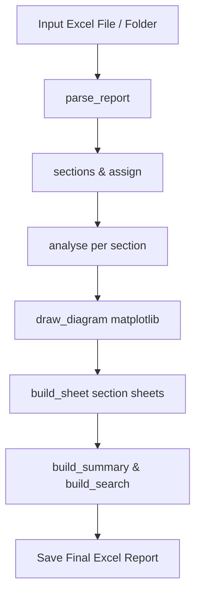

# DNIT 006/2003-PRO Pavement Condition Report Builder

A specialized Python application for parsing automated road pavement inspection Excel reports and generating standardized **DNIT 006/2003-PRO** pavement condition evaluation workbooks with section sheets, summary sheets, search functionality, and visual matplotlib chainage diagrams.

---

## Table of Contents
1. [Overview & Purpose](#overview--purpose)
2. [DNIT Defect Classification & Priority Rules](#dnit-defect-classification--priority-rules)
3. [Core Processing Workflow](#core-processing-workflow)
4. [Chainage Diagram Specs & Rules](#chainage-diagram-specs--rules)
5. [Excel Sheet Structure](#excel-sheet-structure)
6. [How to Run](#how-to-run)
7. [Script Reference](#script-reference)

---

## Overview & Purpose

The report builder reads raw pavement defect extraction files (`.xlsx`) containing anomaly coordinates, chainages, and defect names, and transforms them into standard DNIT compliance reports.

### Key Features
- **Configurable Section Length**: Custom section lengths (e.g. 100 m, 200 m, 300 m) per sheet.
- **DNIT 20 m Stations**: Every section is evaluated in 20 m sub-stations ($S1, S2, \dots$).
- **Matplotlib Chainage Diagram**: Every section sheet includes a high-resolution visual diagram embedded at cell `A10`.
- **Vertical Anomaly Stacking**: Close or overlapping anomalies at the same chainage are vertically stacked as individual small rectangular markers with equal spacing, without merging or changing horizontal chainage positions.
- **Batch Processing**: Supports both single `.xlsx` files and automated directory batch processing via CLI and PyQt5 GUI.

---

## DNIT Defect Classification & Priority Rules

The standard DNIT 006/2003-PRO standard categorizes defects into 8 primary types with designated weighting factors ($f_p$):

| DNIT Type | Code | DNIT Category Name / Description | $f_p$ Weight | Mapping Names |
|:---:|:---:|:---|:---:|:---|
| **1** | `TLC`, `TTL`, `TTC` | Isolated Cracks (Longitudinal / Transverse) | `0.2` | `CRACK L H`, `CRACK L/H`, `LONGITUDINAL CRACK`, `TRANSVERSE CRACK` |
| **2** | `J`, `TB` | FC-2 Alligator Cracking (without edge erosion) | `0.5` | `ALLIGATOR CRACK`, `ALLIGATOR CRACKING` |
| **3** | `JE`, `TBE` | FC-3 Alligator Cracking (with edge erosion) | `0.8` | `ALLIGATOR CRACK WITH EROSION` |
| **4** | `ALP`, `ATP`, `ALC` | Plastic Deformation / Rutting / Corrugation | `0.9` | `RUTTING`, `PLASTIC DEFORMATION` |
| **5** | `O`, `P`, `E` | Pothole (`O`), Deteriorated Patch, Edge Break | `1.0` | `POTHOLE`, `POT HOLE` |
| **6** | `EX` | Existing Patch (any condition) | `0.5` | `PATCH`, `PATCHING` |
| **7** | `D` | Surface Disintegration / Delamination | `0.3` | `SURFACE DELAMINATION`, `DELAMINATION` |
| **8** | `R` | Raveling (loss of aggregate) | `0.6` | `RAVELLING`, `RAVELING` |
| *9* | `-` | Bleeding (Recorded only; excluded from IGG) | `0.0` | `BLEEDING` |

### Station Priority Rule ($f_p$)
For each 20 m station ($S_i$), the script finds all anomalies located inside that station. The station summary color and code reflect the **highest priority defect** (maximum $f_p$) present within that station:
$$\text{Priority Rank: } 1.0 \text{ (Type 5)} > 0.9 \text{ (Type 4)} > 0.8 \text{ (Type 3)} > 0.6 \text{ (Type 8)} > 0.5 \text{ (Type 2/6)} > 0.3 \text{ (Type 7)} > 0.2 \text{ (Type 1)}$$

---

## Core Processing Workflow



### 1. `parse_report(path, side_override, section_len)`
- Reads header information (segment name, survey date, start/end chainages, lane number, direction, road side).
- Scans all anomaly rows and normalizes defect names via `norm()`.
- Maps defect names to DNIT codes ($1..8$) using the `KNOWN` dictionary.

### 2. `sections(info, section_len)` & `assign(info, secs, section_len)`
- Divides total survey length into $N$ section blocks of length `section_len` (default 100 m).
- Assigns each anomaly to its corresponding section based on distance from start.

### 3. `analyse(s)`
- Evaluates each 20 m station inside the section.
- Determines the worst defect code and highest $f_p$ for each station.
- Calculates the section IGG index:
  $$\text{IGG} = \sum_{t=1}^8 \text{IGI}_t, \quad \text{where } \text{IGI}_t = f_r(t) \times f_p(t), \quad f_r(t) = \frac{\text{FA}_t}{n} \times 100$$

### 4. `draw_diagram(info, s, lane_w, section_len)`
- Renders Matplotlib diagram with twin axes (`ax` for lane & individual anomalies, `ax2` for bottom 20 m station summary bar).
- Embeds output PNG directly into cell `A10` of each section sheet.

---

## Chainage Diagram Specs & Rules

- **Top/Middle Lane Display**:
  - Displays individual anomalies at exact horizontal chainage positions (`x`).
  - Uses simple vertical rectangular markers (`Rectangle`) colored by individual defect type (`col`).
  - **Vertical Stacking**: When 2, 3, 4, or more anomalies occur at the same or very close chainage (within 2 m threshold), they are automatically grouped into a cluster and stacked vertically with equal spacing (`spacing = 0.85 m`).
  - **Legible ID Labels**: Each marker displays its own anomaly ID label box directly adjacent to it.
- **Bottom Station Summary Bar**:
  - Colored according to the worst defect category ($f_p$) selected for each 20 m station ($S1, S2, \dots$).
- **Explanatory Note**:
  - Displays dynamic note line at the bottom clarifying Top/middle (individual defect position and color) vs. Bottom (20 m station priority color summary).

---

## Excel Sheet Structure

1. **Summary Sheet**:
   - Lists survey overview metadata.
   - Summary table of all section sheets, total anomalies, stations affected %, IGG index, and pavement condition class (Otimo, Bom, Regular, Ruim, Pessimo).
   - Road condition class distribution and defect type totals.
2. **Search Sheet**:
   - Interactive lookup tool allowing users to enter a chainage (e.g. `200+350` or `200350`) or sheet number to inspect and jump directly to the target sheet.
3. **Section Sheets** (`000+000 to 000+100`, etc.):
   - Header summary banner.
   - Matplotlib chainage diagram image at cell `A10`.
   - **Anomaly Table**: Lists every anomaly with its `No.`, `Station` (`S1`, `S2`...), `Chainage`, `Distance`, `DNIT Code`, `DNIT Type`, `fp`, and coordinates.
   - **DNIT Stations Table**: 20 m station summary (`S1`, `S2`...) with anomaly numbers in station, worst type, and $f_p$.
   - **IGG Calculation Table**: Evaluates all 8 DNIT defect types ($f_r$, $f_p$, $\text{IGI}$).
   - **Final Result Banner**: Shows final section IGG value and pavement condition classification.

---

## How to Run

### Command Line Interface (CLI)

```bash
# Process a single Excel report (default 100 m sections)
python3 road_report_builder_copy.py input_report.xlsx output_report.xlsx Auto 100

# Process a single report with 200 m section length
python3 road_report_builder_copy.py input_report.xlsx output_report.xlsx Auto 200

# Batch process an entire directory of Excel reports
python3 road_report_builder_copy.py /path/to/input_folder /path/to/output_folder Auto 100
```

### Graphical User Interface (GUI)

Launch the PyQt5 GUI by running the script without CLI arguments:
```bash
python3 road_report_builder_copy.py
```

1. **Step 1**: Select a single `.xlsx` file OR a folder for batch processing.
2. **Step 2**: Configure section length (e.g., 100 m, 200 m, 300 m), road side (Auto, RHS, LHS), and lane width.
3. **Step 3**: Click **GENERATE REPORT(S)**.

---

## Script Reference

- `road_report_builder_copy.py`: Primary production script containing parser, diagram renderer, openpyxl builder, GUI, and CLI.
- `m.py`: Synchronized secondary script matching report builder functionality.
