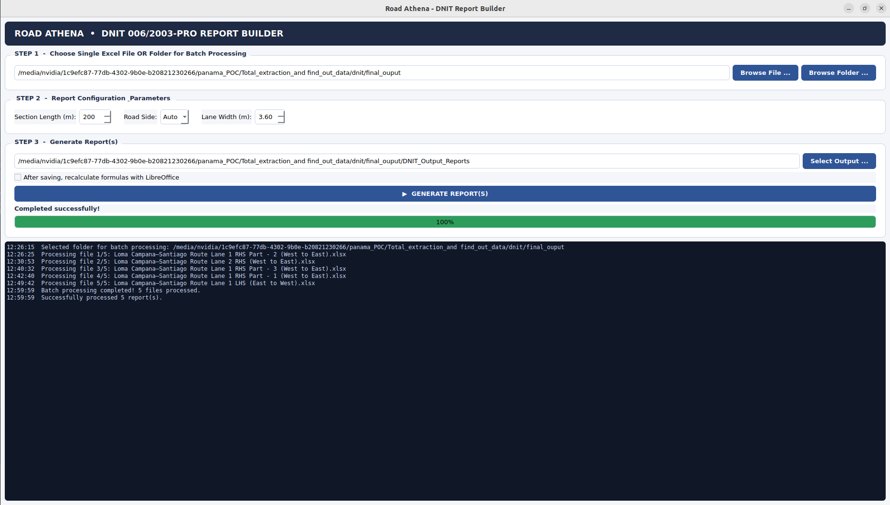
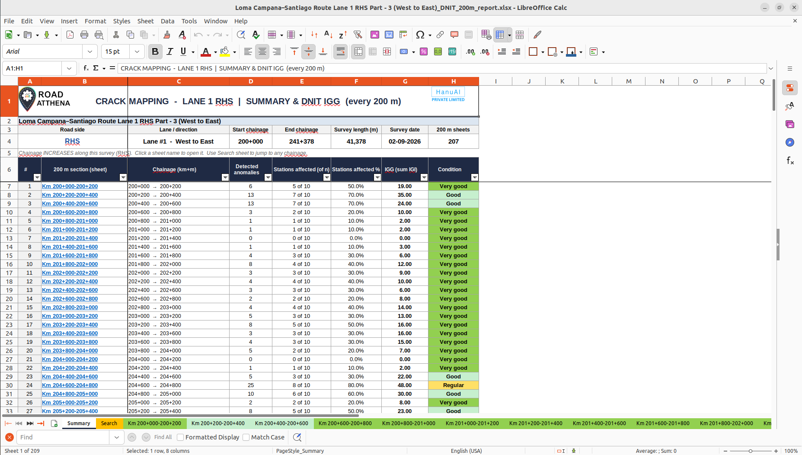
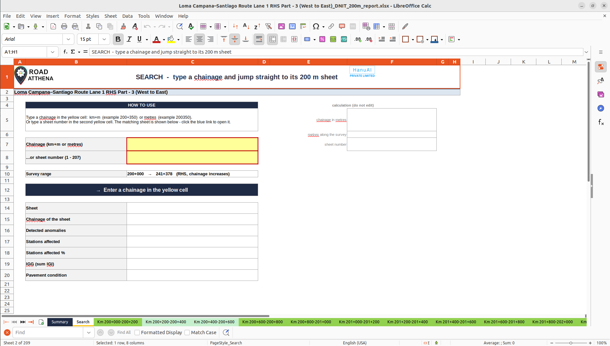
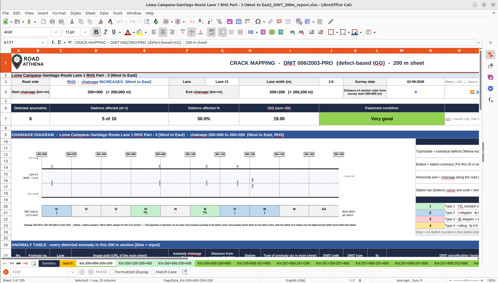

# DNIT 006/2003-PRO Pavement Condition Report Builder

A Python application for analyzing road pavement inspection Excel files and generating structured DNIT pavement condition reports. It creates section-wise Excel reports, pavement condition summaries, chainage diagrams, defect search sheets, and IGG calculations.

**GitHub Repository:** https://github.com/NagendraHanuai/dnit-road-report-builder

## Features

- Process individual Excel reports or batches of reports.
- Configure section lengths such as 100 m, 200 m, or 300 m.
- Divide road sections into 20 m DNIT stations.
- Classify pavement defects and apply defect priority weights.
- Generate chainage diagrams with individually labeled anomaly markers.
- Display anomaly locations and station priority colors.
- Calculate IGG values and pavement condition classifications.
- Generate summary sheets, search sheets, and detailed section sheets.
- Provide both a command-line interface (CLI) and a graphical interface (GUI).

## Project Structure

```text
dnit-road-report-builder/
├── road_report_builder_copy.py
├── README.md
├── 1st_ui.png
├── output_200m_sheet.png
├── output_summary_sheet.png
└── output_search_sheet.png
```

## Screenshots

### Application Interface



### Summary Sheet



### Search Sheet



### 200 m Section Report



## Requirements

- Python 3
- pip
- pandas
- openpyxl
- matplotlib
- numpy
- PyQt5 for the graphical interface

The exact dependencies depend on the imports used in `road_report_builder_copy.py`. Verify them before deployment.

## Installation

### 1. Clone the repository

```bash
git clone https://github.com/NagendraHanuai/dnit-road-report-builder.git
cd dnit-road-report-builder
```

### 2. Check Python and pip

```bash
python3 --version
python3 -m pip --version
```

### 3. Create a virtual environment

```bash
python3 -m venv .venv
source .venv/bin/activate
```

If the virtual environment module is unavailable, install the appropriate Python venv package using your operating system's package manager.

### 4. Install Python dependencies

```bash
python3 -m pip install numpy pandas openpyxl matplotlib PyQt5
```

For a headless system, the CLI may work without a graphical desktop, but GUI execution requires a suitable graphical environment and Qt dependencies.

## How to Run

### Command-Line Interface (CLI)

Process one Excel report using 100 m sections:

```bash
python3 road_report_builder_copy.py input_report.xlsx output_report.xlsx Auto 100
```

Process one Excel report using 200 m sections:

```bash
python3 road_report_builder_copy.py input_report.xlsx output_report.xlsx Auto 200
```

Process a directory of Excel reports in batch mode:

```bash
python3 road_report_builder_copy.py /path/to/input_folder /path/to/output_folder Auto 100
```

Replace the example paths with your actual input and output paths.

### Graphical User Interface (GUI)

Run the application without command-line arguments:

```bash
python3 road_report_builder_copy.py
```

1. Select an Excel report or an input folder.
2. Choose the section length.
3. Select the road side: Auto, RHS, or LHS.
4. Set the lane width if required.
5. Click **GENERATE REPORT(S)**.
6. Open the generated Excel reports and inspect the summary, search, and section sheets.

## DNIT Defect Classification

The application maps pavement defect names to DNIT categories and associated priority weights.

| DNIT Type | Defect category | Weight |
|---|---|---:|
| 1 | Isolated longitudinal/transverse cracks | 0.2 |
| 2 | Alligator cracking without edge erosion | 0.5 |
| 3 | Alligator cracking with edge erosion | 0.8 |
| 4 | Plastic deformation and rutting | 0.9 |
| 5 | Potholes, deteriorated patches, and edge breaks | 1.0 |
| 6 | Existing patches | 0.5 |
| 7 | Surface disintegration and delamination | 0.3 |
| 8 | Raveling | 0.6 |
| 9 | Bleeding (recorded separately) | 0.0 |

The mappings and weights above describe the application's configured rules. Confirm the implementation against the applicable DNIT standard before using the results for formal engineering decisions.

## Processing Workflow

1. Read the input Excel report.
2. Extract road information, chainage, anomaly IDs, and defect classifications.
3. Divide the surveyed road into configurable sections.
4. Assign anomalies to sections and 20 m stations.
5. Determine station priority using the configured defect weights.
6. Generate chainage diagrams using Matplotlib.
7. Build the detailed Excel sheets.
8. Generate summary and search sheets.
9. Save the final report workbook.

## Generated Excel Sheets

### Summary Sheet
Provides road survey information, section summaries, anomaly counts, IGG results, and configured pavement condition classifications.

### Search Sheet
Helps locate road sections using chainage values or section identifiers, depending on the implemented search functionality.

### Section Sheets
Contain section metadata, a chainage diagram, anomaly details, 20 m station summaries, and IGG calculation tables.

## IGG Calculation

The configured calculation uses:

\[
f_r(t)=\frac{FA_t}{n}\times100
\]

\[
IGI_t=f_r(t)\times f_p(t)
\]

\[
IGG=\sum_{t=1}^{8}IGI_t
\]

Where:

- \(FA_t\) = number of affected stations for defect type \(t\).
- \(n\) = total number of evaluated stations, as implemented by the application.
- \(f_r(t)\) = configured relative frequency factor.
- \(f_p(t)\) = configured defect weighting factor.
- \(IGI_t\) = individual defect index.

Verify the application's counting rules and classification thresholds against the applicable DNIT methodology before relying on the computed IGG for official reporting.

## Troubleshooting

**Missing Python modules**

```bash
python3 -m pip install numpy pandas openpyxl matplotlib PyQt5
```

**GUI does not open**

Check that a graphical desktop is available and that the Qt dependencies are installed.

**Excel file not found**

Use the full input file path and verify that the file exists and is readable.

**Output folder problems**

Ensure that the output directory exists or that the application can create it and has write permission.

## Main Script

`road_report_builder_copy.py` contains the report processing logic, diagram generation, Excel workbook generation, and CLI/GUI entry points.

## License

No license has been specified yet. Add a license file if you intend to define the conditions under which others may use or redistribute the project.

---

**Disclaimer:** This tool generates reports using its configured mappings and calculations. Validate the implementation and results against the applicable DNIT requirements before official use.
